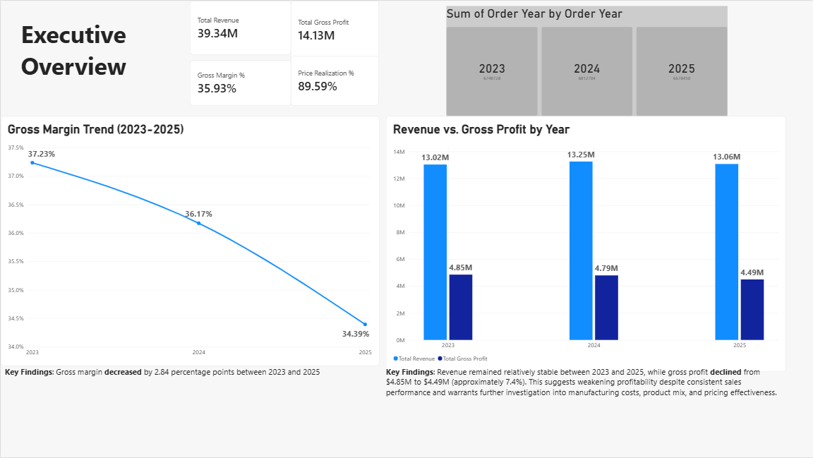
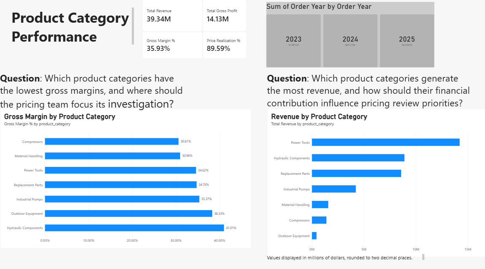
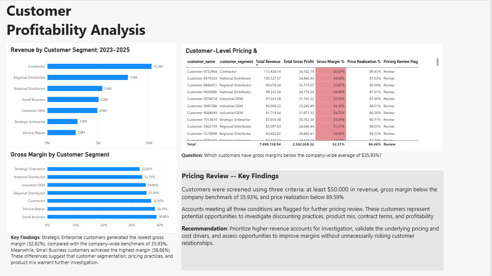

#Power BI | Pricing & Profitability Dashboard

## Project Overview

Developed an interactive Power BI dashboard using a synthetic B2B sales dataset to evaluate revenue performance, gross margins, customer profitability, and potential pricing review opportunities.

The dashboard builds on six SQL analyses conducted in MySQL and translates analytical findings into business-focused visualizations.

**Dataset:** 10,000 orders | 750 customers | 50 products | 2023–2025

## 1. Executive Overview

**Business Question:** How has overall financial performance changed between 2023 and 2025?

**Key Findings:**
- Total revenue: approximately $39.34 million.
- Total gross profit: approximately $14.13 million.
- Overall gross margin: 35.93%.
- Gross margin declined from 37.23% in 2023 to 34.39% in 2025, a decrease of 2.84 percentage points.

## 2. Product Category Performance

**Business Question:** Which product categories generate the most revenue, and where are profitability concerns most visible?

**Key Findings:**
- Power Tools generated approximately $4.76 million in revenue in 2025.
- Compressors recorded the lowest category gross margin in 2025 at 29.08%.
- Hydraulic Components recorded the highest category gross margin in 2025 at 39.78%.

Category comparisons help identify where pricing and cost analysis may warrant additional attention.

## 3. Customer Profitability

**Business Question:** Which customer segments and individual accounts may warrant additional pricing review?

**Key Findings:**
- Contractors generated approximately $10.26 million in revenue across 2023–2025.
- Strategic Enterprise had the lowest segment gross margin at 32.82%.
- Small Business had the highest segment gross margin at 38.86%.

A customer-level pricing review screen flags accounts meeting three criteria:

- Revenue of at least $50,000.
- Gross margin below the company benchmark of 35.93%.
- Price realization below the company benchmark of 89.59%.

Flagged accounts represent candidates for further investigation, not automatic price increase recommendations.

## Tools & Techniques

**Power BI:** Data modeling, DAX measures, KPI cards, interactive filtering, conditional formatting, and profitability dashboards.

**MySQL:** Exploratory data analysis, revenue and margin calculations, customer segmentation, pricing review screening, and price trend analysis.

## Dashboard File

[Open or download the Power BI project](Pricing_Profitability_Dashboard.pbix)

*Power BI Desktop is required to open the interactive `.pbix` file.*

## Next Steps

- Expand the dashboard with selling price and manufacturing cost trend analysis.
- Investigate product categories experiencing margin compression.
- Develop additional pricing opportunity insights and recommendations.**
